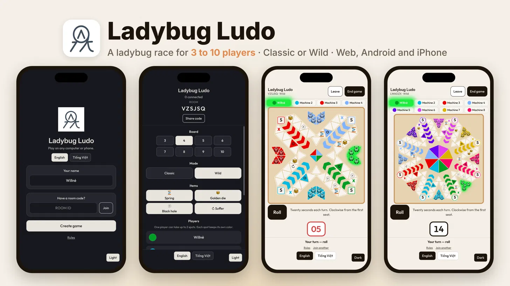

  

<h1 align="center">Ladybug Ludo</h1>

  A ladybug race for 3 to 10 players. 
  Classic or Wild. Your phone keeps your name. The room only borrows a code.

  <a href="#how-a-room-connects">How it works</a>
  ·
  <a href="https://github.com/LiamTrinhNguyen/ledo-deluxe-ladybug-race/issues">Ideas and suggestions</a>
  ·
  <a href="#privacy">Privacy</a>
  ·
  <a href="#copyright">Copyright</a>

---

## What it is

Ladybug Ludo is a clockwise race. Each seat has four ladybugs, and the first player to bring all four home wins.

- **Leaving the base.** You need a 6 to bring a ladybug out of its base, and every 6 gives you another roll. Three unused 6s in one turn end it.
- **Sending home.** Land exactly on another colour to send it back to its base and roll again. Passing over it does nothing.
- **Safe squares.** S (your start) and O are safe. X is the last square before your home lane, and it is not safe.
- **Blocks.** Two ladybugs of one colour on a normal square form a block. Nobody may land there, and the pair can't be sent home.
- **Finishing.** A ladybug must reach the centre with an exact count along its coloured home lane. The centre shows how many of yours are home.
- **The clock.** Twenty seconds for each roll and each move. If time runs out, the game plays for you.

**Wild mode** adds four items to the track: a **jump spring** (1 to 8 squares forward), a **black hole** (1 to 8 squares back), a **golden die** (a saved 6 for later), and **suffer** (shuffles every ladybug on the main track). The host can turn each one off before the game starts.

Play on the web, or from the iPhone and Android builds. A game against machine players never leaves the device. A room with other people connects the devices directly after a short handshake. Rules, buttons and messages come in English and Vietnamese, with light and dark looks and original background music.

> Ladybug Ludo was called **Ludo Delux** before. The name changed because "Ludo Deluxe" is already a common name for editions of the board game.

## How a room connects

  

1. **Handshake.** Each device asks the mailbox on Vercel who is in the room. Vercel keeps that short list in Neon and clears it within 60 seconds.
2. **Realtime.** Every device then links directly to every other, over an encrypted connection. Each device proves which seat it is, the host applies each move and sends the board to all, and every device checks each update before showing it. Dice and moves do not pass through Vercel or Neon.

When two devices cannot reach each other directly, a Cloudflare relay carries that one link. The traffic stays encrypted.

If the host's phone goes to sleep or drops out, the next player takes over as host and the game carries on.

## Stack

| Piece | Where |
|---|---|
| App | TypeScript, React, Vite |
| Phone builds | Capacitor (iOS and Android) |
| Hosting | [Vercel](https://vercel.com) |
| Temporary room data | [Neon](https://neon.tech) Postgres |
| After the handshake | An encrypted direct connection (WebRTC) between the players' devices |
| When no direct path exists | Cloudflare relay |

The source code is private. This repository holds the public description, the policy, and the issue list.

## Ideas and suggestions

Open an issue: [github.com/LiamTrinhNguyen/ledo-deluxe-ladybug-race/issues](https://github.com/LiamTrinhNguyen/ledo-deluxe-ladybug-race/issues)

Use that list for a rule that feels wrong, a board that does not fit the phone, or a feature you want next. One issue per idea.

## Privacy

Last updated: November 28, 2026.

The App Store and Google Play listings point at this same policy, which is also shown in the app at `/privacy`.

### Summary

Ladybug Ludo has no accounts, no advertising, and no analytics. We do not sell or share personal information.

### What stays on your device

The name you type, a random id for your device, and your Dark and Music settings are saved on your device only, so the game can remember them next time. A game against machine players never leaves your device.

### What happens when you join a room

To connect players, our server briefly holds the room code, a temporary random connection id, and the connection messages your device exchanges with the other players. These messages include network addresses. Each message is deleted as soon as it is delivered, or after 60 seconds, and a player is removed from the room list after 30 seconds of inactivity.

After that, the game runs directly between the players' devices. Your name, your device id, and your moves are sent to the other players in your room, and their devices can see your network address, as with any direct connection. Our server does not receive them.

### How the connection is kept secure

- Your device talks to our server only over HTTPS. The game between players runs over WebRTC, which always encrypts it (DTLS), so nobody between the devices can read or change the moves.
- Only people who have your room code can join your room. Share it only with the people you want to play with.
- Each device proves which seat it is when it connects. A roll or a move is accepted only from the player whose turn it is, and only the room owner can change the board or the mode, or start the game, so one player cannot act for another.
- Every game update from another device is checked before it is shown, and anything malformed is ignored.
- When no direct path exists between two devices, the game can pass the encrypted connection through a relay run by Cloudflare. The relay cannot read it.

### Services we rely on

The game is hosted by [Vercel](https://vercel.com) and uses a [Neon](https://neon.tech) database for the temporary room data above. Public STUN servers run by Google and Cloudflare help devices find each other, and Cloudflare may relay a connection as described above. Like any internet service, these providers see the network address of devices that contact them. The fonts and music are part of the app, so nothing is loaded from Google Fonts or any other outside site.

### Children

The game does not ask for or knowingly collect personal information from anyone, including children.

### Changes

If this policy changes, the new version will be posted here with a new date.

### Contact

Questions about this policy: [Liamtrinhnguyen@gmail.com](mailto:Liamtrinhnguyen@gmail.com)

## Copyright

**Ladybug Ludo** © 2026 Liam TrinhNguyen. All rights reserved.

- **The logo** (`public/ladybug-ludo-mark.png`) is the author's own design, as are the banner (`public/ludo-delux-5244x2950.png`) and the connection diagrams (`public/connection.svg`, `public/connection-2.svg`).
- **The background music**, "Ladybug Garden", was composed for this app and generated in code, with no samples or recordings from anyone else.
- **The artwork** (the ladybug tokens, the board designs for 3 to 10 players, the wild-item icons), **the source code**, and the English and Vietnamese text are all original work.

None of these may be copied, changed, or reused without the author's written permission. The name "Ladybug Ludo" and the logo identify this app; please don't use them for another game, app, or product. See [COPYRIGHT.md](COPYRIGHT.md).

Ludo itself is a traditional board game descended from Pachisi, and its basic rules belong to no one. The app is built with open-source software and fonts (Fraunces and Outfit, SIL Open Font License), which keep their own licences.

---

Built by [Liam TrinhNguyen](https://github.com/LiamTrinhNguyen).
